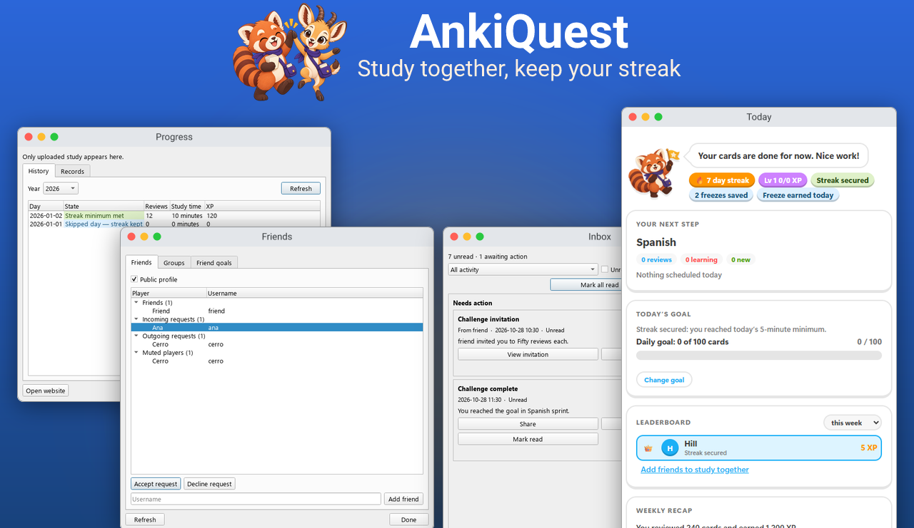

> Anki is hard, free and effective.
>
> Duolingo is easy, commercial and ineffective.
>
> If you ask a random successful language learner what software to use they'll probably suggest Anki.
>
> —lsusr, [Invisible Choices, Made by Default](https://www.lesswrong.com/s/3xKXGh9RXaYTYZYgZ/p/k6nncsXAZD3bK6fe3)

<p align="center">

</p>

<a href="https://github.com/AnkiQuest/AnkiQuest-Desktop/releases/latest"></a>
<a href="https://ankiweb.net/shared/info/414948448"></a>
<a href="https://github.com/AnkiQuest/AnkiQuest-Desktop/actions/workflows/ci.yml"></a>
<a href="https://github.com/AnkiQuest/AnkiQuest-Desktop/actions/workflows/addon.yml"></a>
<a href="https://github.com/AnkiQuest/AnkiQuest-Desktop/commits/master"></a>
<a href="https://github.com/AnkiQuest/AnkiQuest-Desktop/graphs/contributors"></a>
<a href="https://github.com/AnkiQuest/AnkiQuest-Desktop/blob/master/LICENSE"></a>

# AnkiQuest-Desktop

The AnkiQuest add-on for Anki desktop.

AnkiQuest leaves Anki's scheduling unchanged and adds streaks, friends and leaderboards to keep you studying.

AnkiQuest adds XP, streaks, daily quests, friends and leaderboards to Anki. Clients send review history without card content; sharing a conquered card label or a deck copy is an explicit choice. AnkiQuest has three repositories:

- [AnkiQuest-Server](https://github.com/AnkiQuest/AnkiQuest-Server): the server and its website.
- [AnkiQuest-Desktop](https://github.com/AnkiQuest/AnkiQuest-Desktop): the Anki desktop add-on.
- [AnkiQuest-Android](https://github.com/AnkiQuest/AnkiQuest-Android): the Android app, a fork of AnkiDroid.

## Install

1. Create an account on an AnkiQuest server, such as [ankiquest.rationality-munich.com](https://ankiquest.rationality-munich.com). To run your own, see [AnkiQuest-Server](https://github.com/AnkiQuest/AnkiQuest-Server).
2. In Anki 24.11 or newer (Qt 6), open **Tools → Add-ons → Get Add-ons** and enter **414948448** ([AnkiWeb listing](https://ankiweb.net/shared/info/414948448)). Restart Anki, then choose **Tools → AnkiQuest → Settings → Account**. AnkiWeb manages updates. The [GitHub package](https://github.com/AnkiQuest/AnkiQuest-Desktop/releases/latest) remains available; remove the other installation before switching channels and sign in with the same AnkiQuest account.
3. Study as usual. Open **Tools → AnkiQuest → Friends** to manage friends and groups, preview a group invitation, or start a friend goal. The website's **Friends** page is also available.

## Development

```sh
python3 -m venv .venv
. .venv/bin/activate
python -m pip install -r tests/requirements-anki-26.9.4.txt
QT_QPA_PLATFORM=offscreen python -m unittest discover -s tests
cargo run --manifest-path tools/package-addon/Cargo.toml -- --output ankiquest.ankiaddon
```

### Screenshots and banner

`docs/screenshots/desktop-*.png` and the banner are drawn, not captured by hand. `tests/draw_screenshots.py` renders each add-on screen offscreen from the fake players and server replies in `tests/screenshots/data.json`, with a fixed clock, the fonts in `tests/screenshots/fonts` and fixed window sizes. The banner tool composes `docs/graphics/banner_readme.png` from those screenshots and the duo art in an [AnkiQuest-Server](https://github.com/AnkiQuest/AnkiQuest-Server) checkout. CI's "Screenshots and banner" job draws all of them again and fails when a committed file differs in any pixel. After changing a screen, regenerate them on Ubuntu 24.04 with the 26.9.4 requirements installed:

```sh
ANKIQUEST_SCREENSHOTS=write python tests/draw_screenshots.py
cargo run --release --manifest-path tools/banner/Cargo.toml -- --server ../AnkiQuest-Server
cargo run --release --manifest-path tools/banner/Cargo.toml -- --server ../AnkiQuest-Server --social
```

Another system or Qt draws slightly different text, so CI fails on pictures drawn there. A failing run keeps its drawings as the `screenshots` artifact.

[Desktop compatibility, tests and packages](docs/desktop.md) has the supported Anki versions, the CI jobs and the release steps. The shared fixtures, API examples and art masters the tests and poses come from are pinned from AnkiQuest-Server ([Server snapshot](docs/desktop.md#server-snapshot)).

## License

AGPL-3.0-or-later.

Anki-tan (`addon/art/anki_tan_*`, and her masters in AnkiQuest-Server's `static/anki-tan/`) is by [Shigeyuki](https://www.patreon.com/Shigeyuki), from the [Anki-tan asset pack](https://shigeyukey.github.io/shige-addons-wiki/Anki-tan.html), licensed [CC BY-SA 4.0](https://creativecommons.org/licenses/by-sa/4.0/). Derivatives of her art are CC BY-SA 4.0 too.
