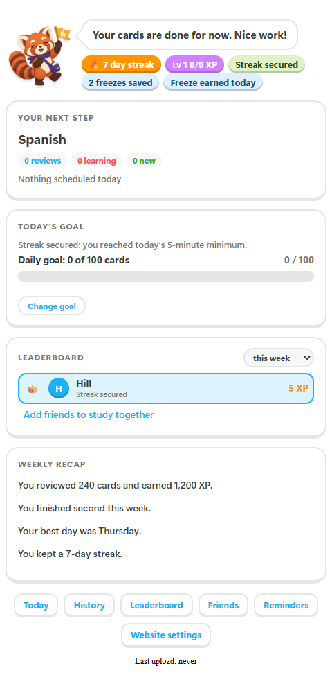
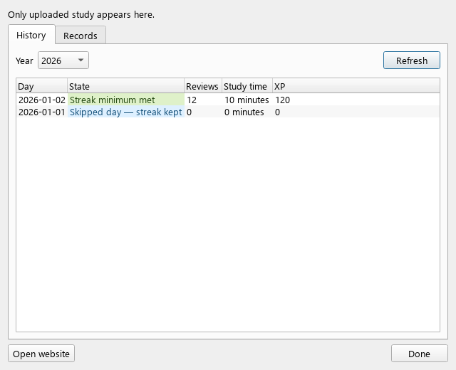
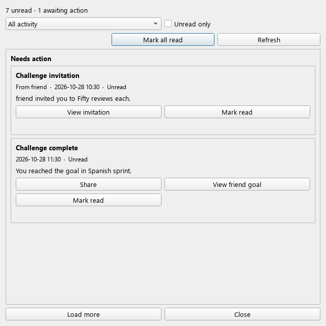

# AnkiWeb listing

Published on 2026-11-11: [AnkiQuest on AnkiWeb](https://ankiweb.net/shared/info/414948448).
Installation code: **414948448**. The content below is the listing copy.
For updates, use the checked `ankiquest-ankiweb-addon` CI artifact from the
intended commit. Its numeric package ID and conflicts differ from the
GitHub archive. Upload it through **Update** on the listing owner's account.

## Title

AnkiQuest — study progress, streaks and friends

## Description

Give your regular Anki study sessions a little company. AnkiQuest adds a
study companion, XP, streaks, daily goals, quests and optional social features
to Anki. It works with Anki 23.10 or newer using Qt 6.
Use a current Anki release for everyday study; 23.10 is the compatibility floor.

- **Today:** see your study progress, next deck, streak status and daily goal
  under the deck list.
- **Progress:** browse your study history and records in a native window.
- **Moments:** celebrate goals and difficult cards after studying. Suggested
  card labels stay on your computer until you choose to save one.
- **Friends:** manage friends and groups, start friend goals, send messages
  and choose whether to appear on the global leaderboard.
- **Reminders:** choose quiet hours and optional system notifications.

After installing, restart Anki and open **Tools → AnkiQuest → Settings →
Account** to sign in or create an AnkiQuest account. You can use the offered
server or your own. AnkiQuest does not replace AnkiWeb synchronization.

AnkiWeb manages updates for this installation. Use **Tools → Add-ons → Check
for Updates**. Do not also install the GitHub package into the same Anki
profile; remove the other installation first. Keep a collection backup and
the same AnkiQuest account when changing installation source.

[Source and support](https://github.com/float3/ankiquest) ·
[Android companion](https://github.com/float3/AnkiQuest-Android) ·
[Self-hosting guide](https://github.com/float3/ankiquest/blob/master/docs/install.md)

## Privacy note

When connected, the add-on uploads review timestamps, card IDs, old and new
intervals, answer time and review type, along with your Anki day settings.
It also uploads deck IDs, names and progress counts to your chosen server.
These are used for progress, XP, streaks, goals and optional deck-completion
sharing. Ordinary review uploads do not contain card text, images or audio.

Your computer keeps a device token after sign-in. The password is not saved
by the add-on. Card labels are sent only when you save them; sending a deck
copy explicitly includes its cards, notes and media. Sharing a public win
link makes that win accessible to anyone with the link.

New profiles are public and listed on the global leaderboard by default.
Review **Public profile** in Friends and **Show me on the global leaderboard**
in Settings → Sharing to choose your visibility. Other players outside your
circle see limited leaderboard rows; a public profile also exposes its
public progress page. Your server's privacy notice explains its operator,
hosting and retention. Open it from **Settings → App and privacy → Privacy
notice**. The website's account settings let you export your data or delete
your account.

## Screenshots and captions

**Today:** your companion, streak status, next deck and progress in Anki.

**Progress:** a native history window with the server's study-day states.

**Inbox:** messages and actions in a native window.

## Updating the listing

1. Review and merge the intended change after both desktop CI jobs pass.
2. Download that commit's `ankiquest-ankiweb-addon` artifact. For a local
   build, run `python .github/scripts/package-addon.py --ankiweb --output ankiquest-ankiweb.ankiaddon` from the reviewed checkout.
3. Sign in to the owner account, open the listing, choose **Update**, attach
   the package to the appropriate version branch and save. Keep the actual
   oldest/current tested Anki versions in the branch fields.
4. Download with Anki's **Get Add-ons** code, check the installed version,
   open Settings, and use **Check for Updates** to verify update ownership.

The listing embeds the three screenshots from a pinned public GitHub
commit. Update those URLs when the pictured screens change. AnkiWeb's
package conflicts with `ankiquest`; GitHub's package conflicts with
`414948448`. Anki preserves disabled installations on update. Remove the
other copy before switching channels, restart, and sign in to the same
account on the same server. Account upload checkpoints stay in the Anki
profile and are independent of the installation directory.
